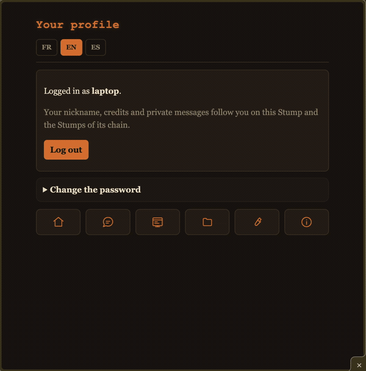
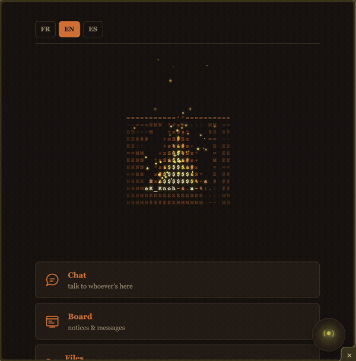
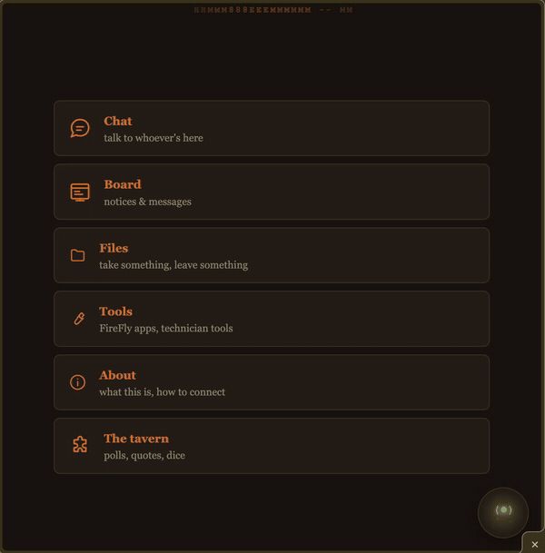
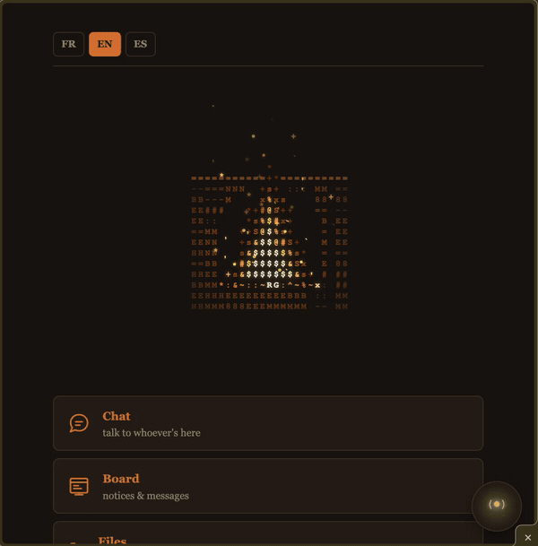

# Project Stump — Beta A (beta testing)

[](https://github.com/ruderigo/LaBuche-Stump/actions/workflows/tests.yml)
[](https://github.com/ruderigo/LaBuche-Stump/releases)

**This repository is where Stump is beta-tested.** Download a release
(`Stump-<version>.zip`: the Provisioner, the firmware and the packs in
one folder) from [Releases](https://github.com/ruderigo/LaBuche-Stump/releases),
check it (`sha256sum -c SHA256SUMS`, `gh attestation verify`, see
[docs/RELEASE.md](docs/RELEASE.md)), and report what you find in Issues.
What changed: [CHANGELOG.md](CHANGELOG.md). The stable line is
[LaBuche-Stump](https://github.com/ruderigo/LaBuche-Stump).

<p align="center">
  <br>
</p>

<p align="center">
  <br>
</p>

<p align="center">
  <br>
</p>

<p align="center">
  <br>
</p>

## What a Stump is

A Stump is an off-grid community node. Walk up with a phone, join its
Wi-Fi, and get a chat room, a bulletin board, a file library and an
About page, in French, English or Spanish. It also holds a
cryptographic identity on the [Reticulum](https://reticulum.network)
mesh, so people reachable only over LoRa radio share the same rooms
as the people standing in front of it.

The same firmware runs on a small board or on a computer, with or
without a radio.

| Stump | Radio | What it adds | Set up with |
|---|---|---|---|
| **ESP32-S3-CAM + Heltec V3** | Heltec V3 over Wi-Fi | The original: a pocket-sized, low-power node with its own Wi-Fi for visitors and an SD card for files | `python3 provisioner.py` → *A Stump CAM*, then *A Heltec for a CAM* |
| **macOS / Windows / Linux + Heltec V3** | Heltec V3 on USB or Bluetooth | A computer as a full node: more storage and speed, on the LoRa mesh directly; USB ⇄ Bluetooth and pairing from `/admin` | `python3 provisioner.py --pc` → the Heltec on USB |
| **macOS / Windows / Linux** | none | A computer as a node with no radio of its own: it reaches LoRa through another Stump it's chained to | `python3 provisioner.py --pc` → no Heltec |

**Three rooms, three reaches.** `#main` stays on its Stump.
`#lora-mesh` is the radio's room: LoRa phones and handhelds land there,
and the Stumps share it — over the radio first when they have one, even
with Wi-Fi between them. `#wifi-mesh` is shared by chained Stumps over
Wi-Fi only.

**Chained Stumps.** Stumps link to each other over Wi-Fi — a CAM's own
Wi-Fi, or the home Wi-Fi they share — and relay for each other, so a
Stump without a radio still reaches the LoRa mesh through one that has
one. A chain is a tree: a new Stump joins whichever is closest, and a CAM
whose Stump above goes away joins another of the same chain in range.
See [Chained Stumps](#chained-stumps).

## Who connects to a Stump

| Client | How it connects |
|---|---|
| **Android** — [FireFly-Android](https://github.com/ruderigo/FireFly-Android) | Over LoRa, through its own Heltec V3, with its own identity; or over Wi-Fi to a Stump, from FireFly's Stump panel |
| **Handheld** (R36S / R36MAX) — [FireFly for RK3326](https://github.com/ruderigo/FireFly_RK3326_R36MAX_R36S) | Over LoRa, through its own Heltec V3, with its own identity |
| **Any phone or computer** | A browser on the Stump's Wi-Fi (or the network it's on) |

## Tested so far (17 Oct 2026, 1.0.0-beta.21)

| | On hardware | In the lab only |
|---|---|---|
| ESP32-S3-CAM + Heltec V3 | ✓ | |
| macOS + Heltec V3 on USB (handshake, status, unplug and replug) | ✓ | |
| macOS + Heltec V3 over Bluetooth (pairing and switching from `/admin`) | in progress | ✓ (simulated RNode, firmware behaviour read from its source) |
| Windows / Linux + Heltec V3 | | ✓ |
| macOS, no radio, chained to a CAM over the home Wi-Fi | ✓ | |
| Windows / Linux, no radio | | ✓ |
| CAM chained to a CAM | | ✓ |
| A CAM joining another Stump when its own goes away | | ✓ (simulated Wi-Fi) |
| `#lora-mesh` between Stumps over the radio, with and without Wi-Fi | | ✓ (two simulated Heltecs over a simulated air) |
| Turning a computer Stump off from `/admin`, Start/Stop files | | ✓ |
| Android (FireFly + Heltec V3) over LoRa | ✓ | |
| Android over Wi-Fi (FireFly's Stump panel) | ✓ | |
| Handheld (FireFly + Heltec V3) over LoRa | ✓ | |
| Browsers: phones, a Windows PC on the home Wi-Fi | ✓ | |
| `#wifi-mesh` between chained Stumps, DMs across Stumps | ✓ | |


---

## Before anything else: access modes are in test

This build ships **three** node-wide access profiles — `open`,
`hybrid`, `mandatory` — plus a separate, newer per-room access system
(minted/invite-only rooms) and a mesh-landing-room feature layered on
top of both. All of this is real, implemented, and passes its own test
suite. **None of it has been field-validated at the scale or duration
this release is going out to.**

**Recommendation for this release: leave `AUTH_MODE` at `open`.**
Everything else in this README about `hybrid`, `mandatory`, room tiers,
and the mesh landing room is accurate and instructions are provided —
use them if you're specifically testing that part of the system. But if
you just want a Stump that works the way every walk-up visitor expects
(anyone can read, anyone can chat, nothing asks for a password), `open`
is the tested, unsurprising choice, and it's the default.

One naming trap worth knowing before you touch any of this: **"hybrid"
means two unrelated things** — the global `AUTH_MODE` (a node-wide
security posture) and a per-room *tier* (a property one specific room
can have, regardless of global mode). A real field test already
confused these two. See [Access control](#access-control) below before
assuming you know what "turn on hybrid" does.

---

## Contents

- [What a Stump is](#what-a-stump-is)
- [Who connects to a Stump](#who-connects-to-a-stump)
- [Tested so far](#tested-so-far-17-oct-2026-100-beta16)
- [Quick start](#quick-start)
- [Reading the boot log](#reading-the-boot-log)
- [Troubleshooting](#troubleshooting)
- [Repository layout](#repository-layout)
- [Architecture](#architecture)
- [Standalone Heltec V3 transport role](#standalone-heltec-v3-transport-role)
- [HTTP API](#http-api)
- [Access control](#access-control)
- [File storage](#file-storage)
- [Billboard](#billboard)
- [Chat and direct messages](#chat-and-direct-messages)
- [Voice notes](#voice-notes)
- [LXMF propagation node](#lxmf-propagation-node)
- [Home page, navigation, About and Tools](#home-page-navigation-about-and-tools)
- [BarKeep, the librarian](#barkeep-the-librarian)
- [HTTPS](#https)
- [Internationalization](#internationalization)
- [Chained Stumps](#chained-stumps)
- [Stump on a computer](#stump-on-a-computer)
- [Plugins and packs](#plugins-and-packs)
- [Configuration](#configuration)
- [Conventions for contributors](#conventions-for-contributors)
- [Testing](#testing)
- [Verification status](#verification-status)
- [Engineering notes](final_firmware/docs/ENGINEERING_NOTES.md): how things came to work this way
- [Credits](#credits)
- [Hidden features](#hidden-features)

---

## Quick start

Download `Stump-<version>.zip` from
[Releases](https://github.com/ruderigo/LaBuche-Stump/releases),
check it (`docs/RELEASE.md`), unzip it, and inside the folder:

```bash
python3 provisioner.py
```

It asks what you're setting up (a CAM, a Heltec for a CAM, a Heltec
relay, a Stump on this computer, or a check or fix), then shows the
**route**: its numbered sections, what each does, how long it takes,
whether it needs you or runs by itself, and what you'll need. A CAM
takes about 30 minutes, most of it copying files to the board over USB:
all its questions come first (about 5 minutes), then the rest runs by
itself while the computer is kept awake.
Each section then opens with a header and where you are on the route,
asks before touching the board, and ends with done, skipped or what
went wrong. The run ends on a summary: each section's result, and what
to keep (addresses, the chain secret, the next command).

Everywhere below, `PORT` means the board's USB serial port, not the
word itself — find it with `--scan` (on a Mac it looks like
`/dev/cu.usbmodem5C372383661`).

```bash
python3 provisioner.py --check-tools      # verify esptool/mpremote/rnodeconf
python3 provisioner.py --scan             # list connected boards and their ports
python3 provisioner.py --upload-app PORT  # update the CAM's code only, no erase; keeps its config.py
python3 provisioner.py --get-ip PORT      # query LAN + hotspot addresses
python3 provisioner.py --diag PORT        # serial, SD and radio checks
python3 provisioner.py --wipe-sd PORT     # reformat a problem SD card
python3 provisioner.py --erase-flash PORT # erase a CAM's or a Heltec's whole flash, to start it over
python3 provisioner.py --list-packs       # the packs in packs/, with their hashes
python3 provisioner.py --install-pack PORT packs/tavern-pack   # add a pack to a node
python3 provisioner.py --remove-plugin PORT tavern             # take a plugin off a node
```

**Updating a CAM that's already deployed:** the wizard's "Flash
firmware" step erases the whole chip, including the node's Reticulum
identity — it comes back with a **new LXMF address**, and mesh clients
(the Android app, Sideband) must pick it again from its next announce.
To update without that, use `--upload-app`: it copies the new files
only, keeping the identity, and the billboard and shared files on the
SD card. **It keeps the node's own `config.py`** — its name, Wi-Fi,
passwords, theme and every other setting stay as they are; settings
added by the new version take their defaults. To replace it with the
`config.py` in the firmware folder, add `--replace-config`, or run the
wizard, answer **no** to "Flash firmware" and **yes** to the config
wizard. (Up to 1.0.0-beta.2, `--upload-app` copied the folder's
`config.py` over the node's — a node's theme changing after an update
was the visible sign.)

`--diag` automates the serial, SD card and radio checks. Network
reachability is confirmed by hand at the end (it prints how): power-
cycle the board, then open its LAN IP (from `--get-ip`) or
`http://192.168.4.1/` on its own hotspot.

The Heltec **Bridge** role needs its WiFi mode set once (the wizard
does this too; the standalone transport role doesn't use WiFi):

```bash
rnodeconf <port> --autoinstall
rnodeconf <port> -w STATION --ssid "..." --psk "..." \
          --ip 192.168.0.222 --nm 255.255.255.0
```

Then join the node's WiFi and open **`http://192.168.4.1/`** (most
phones also pop the page up on their own, as a captive portal). By
default the network is named `LaBuche-Stump.web.app` — a real,
publicly hosted page explaining what the network is, so anyone can
read it off their phone's WiFi list and look it up on their own data
before ever joining. The Provisioner wizard also offers a custom name
instead, with or without the AP's own IP appended (see
[Configuration](#configuration)).

---

## Reading the boot log

Connect with `mpremote connect <port>` and reset. A healthy boot prints,
in order:

```
Project Stump -- Beta A
[ap] 'LaBuche-Stump.web.app' up on 192.168.4.1 (active=True)
[fserv] SD mounted at /sd
Ed25519/X25519: fast IRAM crypto active
[fservbot] active: prefix '!', 7 trigger(s), notice off
[stumpid] active: mode=open
[plugin] active: fservbot, stumpid
[web] serving on port 80
[dns] captive portal answering on port 53 -> 192.168.4.1
LXMF address: <hash>
Announced as: <NODE_NAME>
```

Every line prints **after** the thing it describes succeeded. If a
line is missing, that component failed — and the failure prints its own
reason.

**The crypto line matters more than it looks.** Three possible outcomes:

- `Ed25519/X25519: fast IRAM crypto active` — healthy, ~17.6ms per
  signature verification.
- `SLOW crypto path active (...)` — a native module loaded, but not the
  fast one. Signing and verifying run roughly **80x slower**. Check that
  `lib/ed25519_iram.mpy` is present and matches this board's firmware
  build.
- `NO native crypto module loaded -- running pure Python` — slower
  again. Something is wrong with the upload or the board.

---

## Troubleshooting

**Board won't flash — "No serial data received".**
Try the other USB-C socket on the Freenove first — only one is wired to
the chip's data lines. If that isn't it, enter the ROM bootloader by
hand: hold BOOT, tap RESET, release BOOT.

**"Files don't match the current known-good version".**
Wrong build folder, not corrupted files. The Provisioner refuses
wrong-version folders outright.

**Site can't be reached / connection refused.**
Nothing is listening on port 80. A persistent startup failure now stops
and reports itself after three attempts rather than looping silently —
check the serial console.

**The LoRa bridge periodically drops and re-sends its full radio
config, and effective range shrinks.**
Diagnosed against a real field report. The node's own mesh
announcement (`REANNOUNCE_INTERVAL`, 120s by default) and any message
forwarded to a mesh peer are both fully synchronous — zero yield points
anywhere in that call chain — so each one freezes the *entire* event
loop, including the bridge's own keepalive, for however long the
signing takes. If that freeze outlasts the Heltec's connection
tolerance (observed empirically around 7 seconds of silence), the
bridge disconnects and reconnects, re-sending the complete radio setup.
Mitigated (not eliminated) by priming the bridge's keepalive immediately
before both known-expensive calls — see `prime_all_bridges()` in
`urns/interfaces/wifi_serial.py`.

**A room I tiered isn't gating anyone.**
`/rooms` annotates every non-open room with its tier in brackets. If a
room shows no tag, it's open.

**Mesh peers aren't landing where I told them to expect.**
Check `/admin <password> meshroom` with no argument — it reports the
current setting. If a mesh peer isn't verified and the landing room is
tiered `minted` or `hybrid`, they're redirected to `#main` instead, with
a system message explaining why. See [Access control](#access-control).

**The FireFly Android APK has to go on the SD card with a card reader.**
At ~50 MB it would take about 14 hours over USB, so the provisioner
refuses it and says where it goes (`tools/firefly/` on the card). Until it's
there, the About page's Android card says "Not on this Stump yet".

---

## Repository layout

```
provisioner.py               technician deployment tool (runs on a laptop): flashes,
                              uploads, configures and diagnoses three board roles
packs/                       plugin packs the Provisioner offers (tavern, rnfs) -- docs/PACKS.md
pc/                          Stump on a computer: stump_pc.py and the stand-ins that run
                              the firmware on regular Python (provisioner.py --pc, docs/PC.md)
tests/                       the test suite: python3 tests/run.py (tests/README.md)
bench/                       measurements run on a CAM: relay speed, Wi-Fi, TLS (bench/README.md)
scripts/                     build_micropython.sh, build_release.py, sign_release.py, update_manifest.py
docs/RELEASE.md              how releases are built, signed and checked
.github/workflows/           tests on every push; tested, signed releases on every tag
CHANGELOG.md

final_firmware/              the CAM's firmware (core files hashed in provisioner.py)
├── main.py                  CAM boot entry -- boots example_node.py via boot_common
├── boot_common.py           Shared retry-vs-give-up boot logic main.py delegates to
├── example_node.py          the real CAM boot sequence; wires everything together
├── config.py                ALL CAM configuration lives here
├── node_common.py           shared identity/router bring-up, safe for other firmware to import
├── plugins.py               the plugin API: gates, commands, listeners, pages, timers, safe mode
├── i18n.py                  trilingual (FR/EN/ES) string table + per-visitor language state
├── barkeep.py                HTTP server (the only one), chat console, page router
├── rrc.py                    RRC chat engine — rooms, nicks, history, DMs
├── rrc_ui.py                  RRC web client (mIRC-style), voice notes
├── rrc_mesh.py                 RRC ↔ LXMF bridge; mesh peers join rooms, land per stumpid's setting
├── propagation.py               LXMF propagation node (store-and-forward)
├── radio.py                      the Heltec from /admin: settings, live state, reconnect, Bluetooth, USB ⇄ Bluetooth
├── guard.py                      speed limits and the wrong-password lockout
├── librarian.py                  BarKeep as the librarian: questions -> files, notices, apps
├── chain.py                      a chain of Stumps over Wi-Fi: links, the path, joining another Stump (docs/CHAIN.md)
├── stump_tls.py                   HTTPS with your own certificate
├── billboard.py                 bulletin board storage + rendering
├── fserv.py                      file storage, streaming I/O, credit economy, home branding
├── captive_portal.py              AP bring-up + DNS redirect
├── flasher_ui.py                   browser-based board flasher (WebSerial)
├── lora_boards.py                   LoRa pinout presets (native SPI radio boards)
├── fservbot/                         PLUGIN — channel bot
├── stumpid/                           PLUGIN — identity verification + room + mesh access
├── web/                                Opus and Codec 2 for the browser (WebAssembly)
├── third_party/                         their sources and licences (not uploaded)
├── tools_payload/                      host-side flasher assets (not uploaded to the board)
├── lib/                                 native crypto accelerators
├── peripherals/                          ADC / battery reading (incl. gated-divider boards)
├── docs/                                  COMMANDS, CLIENT_QUICKSTART, PLUGINS, PACKS,
│                                          ENGINEERING_NOTES (how things came to work this way), ...
└── urns/                                  µReticulum: identity, LXMF, crypto, interfaces (the Heltec over Wi-Fi, USB, Bluetooth)
```

**Not part of `final_firmware/` at all**: the standalone Heltec V3 transport role runs
`microReticulum_Firmware`, a real, pre-built, third-party C++ firmware -- flashed and
configured entirely via `rnodeconf`, with no files from this repository involved. See its
own section below for why, and what replaced an earlier, retired approach.

---

## Architecture

### Boot sequence

1. Join upstream WiFi — optional; failure is non-fatal
2. Bring up the node's own AP (`LaBuche-Stump.web.app` by default)
3. Mount SD; migrate any flash-stored billboard onto it
4. Activate plugins (`load_plugins()`)
5. Start Reticulum + LXMF, register delivery identity
6. Start the HTTP server (port 80) and captive-portal DNS (port 53)
7. Start the mesh bridge; announce, then re-announce every `REANNOUNCE_INTERVAL`
8. Announce the **`stump.node` beacon**: a second destination on the
   node's own identity whose only job is to say "this is a Stump".
   Announce data is msgpack `["stump", STUMP_VERSION, NODE_NAME,
   <16-byte LXMF delivery hash>]`. The LXMF delivery announce stays
   exactly as upstream LXMF defines it, so no other client's parser is
   affected. Announced 5 s after boot and every
   `STUMP_ANNOUNCE_INTERVAL` (default 1800 s) — on its own slow cycle,
   offset from the LXMF re-announce, because signing an announce stalls
   the event loop. Path requests for it are answered automatically, so
   a client can also ask on demand. Verified by parsing a real beacon
   announce with upstream Reticulum (`rns` 1.5.4): valid signature,
   `stump.node` aspect, destination hash matching
   `Destination.hash(identity, "stump", "node")`, and the embedded LXMF
   hash matching the node's real delivery destination.
   The node also listens for *other* Stumps' beacons, remembers their
   LXMF addresses, and labels them: `GET /rrc/poll` returns a `stumps`
   list of those nicks, and the web chat shows a small "stump" tag next
   to them in "Message someone" and "Direct Messages" (the nick itself
   is unchanged, so `/msg` works as usual). Order doesn't matter —
   beacon before or after their LXMF announce — and the label follows a
   `/nick` change; the node's own beacon is ignored.

### The single most important structural fact

**This is a cooperative, single-threaded event loop.** Any blocking call
anywhere freezes *everything*. LXMF signing has zero yield points
anywhere in its call chain — confirmed directly — so any send or
announce blocks the whole node for however long that crypto takes. See
[Troubleshooting](#troubleshooting) for the field-diagnosed consequence.

### One server, many modules

**`barkeep.py` owns port 80. Nothing else binds a TCP port.**
`billboard.py`, `fserv.py`, `rrc.py` are pure logic, called directly by
barkeep's router.

### Room traffic is radio traffic

Since `rrc_mesh` forwards room messages to subscribed mesh peers,
**anything posted to a room costs LoRa airtime**. Both the per-room
tier system and the mesh landing room exist partly to keep an anonymous
walk-up visitor's chatter from consuming a mesh peer's airtime budget
by default.

### Import graph (no cycles)

```
example_node → captive_portal, barkeep, fserv, billboard, rrc_mesh, node_common, config
barkeep      → billboard, fserv, rrc, rrc_ui, flasher_ui, i18n
rrc_mesh     → rrc, stumpid.core (soft -- see below)
stumpid.core → rrc, i18n
rrc_ui       → rrc, i18n
billboard    → i18n            (for _extract_ip; must NOT import fserv -- would close a cycle)
```

`rrc_mesh`'s import of `stumpid.core` is wrapped in `try/except
ImportError` — the mesh bridge has no hard dependency on the identity
plugin being installed at all. If `stumpid` isn't present, mesh peers
land in `#main`, exactly as if no landing-room setting had ever been
configured.

---

## Standalone Heltec V3 transport role

A single, battery-powered Heltec V3 — no CAM, no attached host, no
HTTP/chat stack — acting as a real, standalone Reticulum transport
node: it rebroadcasts announces and forwards in-transit packets for
other nodes, extending mesh reach.

**This runs `microReticulum_Firmware`** (github.com/attermann/microReticulum_Firmware),
a real, actively maintained fork of RNode_Firmware with a C++ port of
the Reticulum stack built in — a pre-built, third-party binary, not
any file from this repository. Flashed and configured entirely
through `rnodeconf`, the same tool the "Control Plane" Heltec role
already uses.

**Confirmed working in the field** on this exact board.

### Why this, and not a custom MicroPython app

An earlier version of this role ran a hand-written MicroPython
application (identity + `urns` + a custom LoRa interface) built
specifically for this project. It hit a real, reproducible
`MemoryError` on actual (PSRAM-less) hardware, traced to native crypto
module loading during identity generation, and never got past it —
despite a 70% code-size reduction from pre-compiling to `.mpy`
bytecode and reordering initialization to give the radio first claim
on available heap. `microReticulum_Firmware`, designed from the start
around exactly this board's memory constraints, worked immediately.
That custom application, its config file, and its LED/display
peripherals have been removed from this repository entirely — nothing
from the old approach is still in use.

### Provisioning it

`python3 provisioner.py` offers this as a third board role. The
sequence, run by `flash_heltec_standalone_reticulum()`:

1. **`rnodeconf --clear-cache`** — so a stale, previously-cached build
   is never silently reused instead of the current release.
2. **`rnodeconf --autoinstall --fw-url <microReticulum_Firmware releases URL> <port>`**
   — interactive; rnodeconf asks its own hardware questions.
3. **`rnodeconf <port> -T --freq ... --bw ... --txp ... --sf ... --cr ...`**
   — TNC mode and every radio parameter locked together in **one**
   command, not set separately. Setting these as separate steps risks
   rnodeconf dropping the write cycle or reverting to Normal
   (host-controlled) mode instead of TNC. The wizard prompts for and
   confirms these against the same `DEFAULT_RADIO` values the existing
   Heltec role already uses.

Switching to `-T` makes the board write to EEPROM and immediately
reboot standalone, which drops the serial connection mid-command —
that shows up as a timeout or non-zero exit from `rnodeconf`'s own
perspective. **This is expected**, not a failure; the code treats it
as such and waits before the final verification step, which runs
`rnodeconf --info` and checks the output for `TNC` directly, rather
than trusting the lock command's own unreliable-by-design exit status.

**The one thing no amount of testing from here can close**: radio
parameters have to match whatever your actual deployed Heltec Bridge
units were provisioned with — an operational fact set at flash time on
each existing unit, invisible from source. Confirm this before relying
on a newly-provisioned relay in the field.

### Known limits specific to this role

- `--upload-app` (the CLI shortcut for re-pushing MicroPython files
  without reflashing) doesn't apply here — there are no files to
  upload; the firmware is a single pre-built binary.
- `--diag` now treats this role the same as the existing "heltec"
  RNode role: serial-bridge and SD-card checks correctly skip (neither
  applies — no MicroPython, no SD card), and the radio check
  (`rnodeconf --info`) runs for real, since this role now genuinely is
  RNode-family firmware.

---

## HTTP API

The full route table — every address the node answers, what it takes and
returns — is **Part 5 of `docs/COMMANDS.md`**, kept in one place and
checked against the code (the table that used to sit here had drifted:
it still called `/` the BarKeep console and missed every route added
since). For client builders, `docs/CLIENT_QUICKSTART.md` covers the same
routes from the app side.

Any unmatched path returns the home page with `200` — captive-portal
detection depends on probe requests getting a real HTTP response.

### What ends up in `/sd/tools/`, and why

`provisioner.py` puts a few things on the node's SD card, so a
technician can walk up with only a laptop and download what they need
from `/tools`:

- **`provisioner/`** — `provisioner.py` itself (the exact version the
  node was set up with), this README as `Stump-README.md`, `LICENSE`,
  and `Stump_Beta_A.zip`, the firmware built fresh from the technician's
  own `final_firmware/`;
- **`flasher/`** — the browser flasher's assets (hidden feature HF-001).
  It holds no firmware images: staging a GPL-3.0 RNode image there would
  make the node *convey* it, which needs its source offered alongside
  (see `tools_payload/images/README.txt`);
- **`firefly/`** — the FireFly apps, found by name and offered on the
  About page (anything over 1 MB, like the ~50 MB Android APK, goes on
  the card with a card reader);
- **a `home` folder** next to `provisioner.py` goes to `home/` on the
  card: the node's home page branding (`docs/HOME_BRANDING.md`).

Everything streams from `/tool?f=` in 16 KB chunks. A node with no card
still finishes provisioning; it just can't hand these back. Details and
history: [`ENGINEERING_NOTES.md`](final_firmware/docs/ENGINEERING_NOTES.md#what-ends-up-in-sdtools).

---

## Access control

Two genuinely separate systems. Read this section before touching
either, since conflating them is exactly what confused a real field
test.

### 1. Global `AUTH_MODE` — a node-wide security posture

Set at provisioning time, or live via `/admin <password> mode <m>`:

- **`open`** (default, recommended for this release) — nothing is
  gated. Anyone can read, post, join, DM.
- **`hybrid`** — everyone reads every room (joins it, sees its lines and
  who's there) and writes in `#main`. Writing anywhere else -- any other
  room, private messages -- takes a verified identity: the `/auth`
  challenge, which a FireFly answers with one button. A FireFly over
  LoRa counts as verified (every message it sends is signed, and a
  non-open node only takes signed ones).
- **`mandatory`** (closed) — reading and writing both take a verified
  identity. Before `/auth`, a web client's poll comes back empty, with
  the topic saying why; only `/auth`, `/whoami`, `/help` work.

**Status: implemented, unit-tested, not field-hardened.** Use `hybrid`
or `mandatory` if you're specifically testing identity verification;
otherwise stay on `open`.

### 2. Per-room tiers — a property of one specific room

Independent of global mode, and it stays in effect **regardless of
which global mode is active** — a tiered room's own gate runs
unconditionally, even under global `open`, on purpose. Tiers:

- **open** (the default for any room that's never been touched)
- **minted** — only a verified identity may join. No exceptions.
- **hybrid** *(the other "hybrid" — see the warning at the top of this
  README)* — a verified identity joins freely; anyone else needs an
  invite from someone verified who is **already in that room**.

```
/admin <password> room <name> <open|minted|hybrid>   -- create or re-tier a room
/admin <password> reset-access                        -- back to config.py's mode, no tiers
/invite <nick>                                        -- invite someone into the room you're in
```

`/rooms` shows each non-open room's tier in brackets:
```
#main  (3 here)  -- General. Be decent.
#lounge  (2 here)  [hybrid]
```

**Status: implemented, tested against every combination with the
global mode above, not field-hardened.**

### 3. The mesh room

A LoRa mesh user who messages the node lands in **`#lora-mesh`**, always there
and seeded like `#main`, and is told so (`→ #lora-mesh`). If `#lora-mesh` has been
given a tier (`/admin <password> room lora-mesh minted`) and they don't
qualify, they land in `#main` instead, told why. `/admin <password>
meshroom` shows `#lora-mesh`'s current tier.

**Status: tested across all three global modes; not yet exercised
against a real mesh peer on real hardware.**

### 4. `/admin` — the node's own admin page

No page links to it: type the address. One password, stumpid's
`AUTH_ADMIN_PASSWORD`, or fservbot's operator password if it has none.
Logging in starts a session: a cookie, forms that carry the session
rather than the password, **Log out** at the top and bottom, and an end
after 30 minutes unused or at restart. After 5 wrong passwords that
visitor waits 30 s, doubling each time up to 15 minutes. With a
certificate installed, the page moves to HTTPS.

The page opens on **tiles** — radio, chain, people in the chat, files —
that open their section. The sections come in groups (*On the air*,
*Content*, *Look*, *System*), each a card that folds open with a short
status by its title; the cards left open stay open on that device.

| Section | What it does |
|---|---|
| Files | Tick files on the shared shelf; delete them together |
| Billboard | Tick posts (title and body shown); delete exactly those |
| Radio (Heltec Bridge) | The radio live first (signal, noise, channel load, battery, packets); *Settings*, folded: frequency, bandwidth, TX power, spreading factor, coding rate, checked, saved in `/radio.json`, sent to the Heltec at once (all but TX power must match the mesh); whether the chat's profile pop-up offers them too; *Transport*, folded ("Transport: USB"): the **USB ⇄ Bluetooth** switch on a computer, **Reconnect the radio**, and Bluetooth: *Pair this computer* / *Pair a device* (the code shown here), on, off, *Forget paired devices* |
| Theme for everyone | Amber, Phosphor, OLED, Paper or a pack's theme, for every visitor, saved in `/site_theme.json`; *As set up* goes back to `THEME` in `config.py` |
| Order | Drag (arrows on a phone) the navigation buttons and home tiles; hide or show each; saved in `/layout.json` |
| Home page section | The `home/` branding: where it goes, frame height, shown or not (`docs/HOME_BRANDING.md`) |
| Tools page | Delete sections or files from the card's `tools/` |
| Stump settings | The Provisioner's answers, changed in place, no reinstall: name, bot's name and auto-reply, file sharing (free / standard / custom weights), who may enter (open / hybrid / mandatory), features, the librarian's firefly on or off, and on a computer its storage (`PC_STORAGE_MB`). Identity, history, files and radio are kept |
| Plugins | Each plugin's state and memory; switch one off |
| Propagation node | On/off, status, a test mailbox, leave a message for an address |
| Stump chain | This Stump's place, the one above, who's below |
| HTTPS | Certificate status, expiry, days left |
| This Stump on the computer (*Restart* on a CAM) | **Restart the Stump** (applies settings waiting for it); a computer Stump only: **Turn off this Stump** (the radio off first); started again from *Start Stump* in its folder |
| This browser only | A theme, a five-colour palette and an SVG logo for that one browser (`localStorage`: nothing changes for others) |

How posts are identified, why the radio values are parsed as text, and
the bugs fixed along the way:
[`ENGINEERING_NOTES.md`](final_firmware/docs/ENGINEERING_NOTES.md#the-admin-page).

---

## Registered profiles (people without a FireFly)

`/profile` (linked from the chat's own pop-up and the Files page): a
nickname and a password. Logged in from any browser, a profile carries
its nick (no one else can take it, and the chat keeps it), its credits
and its private messages, on this Stump and every Stump of its chain --
the records go over the chain link only (never the radio), and a Stump
takes them in only from a signed message that came in on a chain link.
Credits are counted per Stump and merged, so spending on two Stumps
before they sync loses nothing; the same nick registered on two Stumps
before they sync: one keeps it, the other becomes `nick-xxxx`.
Passwords are salted and hashed; wrong ones get the `/admin` lockout.
There's no email: `/admin` → System → *Registered profiles* resets a
password or deletes a profile (chain-wide). A profile doesn't let you
write in `hybrid`'s other rooms -- that takes a FireFly's `/auth`.

Visitors without a profile: a browser keeps a visitor ID (a cookie)
rather than being known by its address; a client that keeps no cookies
(the FireFly app) stays known by its address. Rate limits count per
address either way.

## File storage

`/sd/shared/`, where visitors' uploads land, is capped at **75% of the
card** (`fserv.MAX_SD_RATIO`), checked before the first byte of an
upload is read. Over the cap, the oldest shared files are removed one
at a time until the new one fits; if even that isn't enough, the upload
gets `507`. Only `shared/` is ever trimmed: `tools/`, `fw/`, `about/`
and `home/` are never touched.

Uploading is on the Files page, shown only with a card in. File names
are made safe for the card's FAT filesystem (`< > : " / \ | ? *`
replaced) and sent URL-encoded, so any name works, accents and emoji
included. With credits on (`CREDITS_ENABLED`), uploading earns credits
by kind (`CREDIT_WEIGHTS`) and downloading spends them; the ledger is
saved whole or not at all. Apps get JSON answers
(`docs/CLIENT_QUICKSTART.md`).

The upload failures found in the field and how they were fixed:
[`ENGINEERING_NOTES.md`](final_firmware/docs/ENGINEERING_NOTES.md#file-storage).

---

## Billboard

A post is a title (80 characters) and an optional body (600, line
breaks kept). The page lists titles, newest first; a body opens with a
tap (`<details>`, no JavaScript). Posts are kept **72 hours**
(`BILLBOARD_TTL_SECONDS`), at most 150 on the card
(`MAX_ENTRIES_STORED`, 50 shown), one line each in a file on the SD card
(internal flash without one), rewritten whole or not at all. Expiry
only trusts a set clock: posts made while the clock was unset count from
when it's set. Each visitor can post 3 times a minute
(`BILLBOARD_POSTS_PER_MIN`).

`POST /post` takes `title=` and `body=` (or the older `entry=`), or JSON;
with `Accept: application/json` it answers with the post's `id` or an
error token. Moderation is on `/admin`. History:
[`ENGINEERING_NOTES.md`](final_firmware/docs/ENGINEERING_NOTES.md#billboard).

---

## Chat and direct messages

Rooms: `#main` (this Stump only), `#lora-mesh` (where LoRa phones and
handhelds arrive, shared by the Stumps over the radio first; `#lxmf`
before 1.0.0-beta.4, and the old name still works), `#wifi-mesh` on a
Stump in a chain (shared over Wi-Fi only) and any made with `/join`. Who
may be in `#lora-mesh` follows the access mode, like every room
(`LORA_MESH_LOCKED = True` in config.py keeps it, on a computer with its
own Heltec, to LoRa users, the computer's owner and whom they
`/lora invite`).
Every command and reply is in
[`docs/COMMANDS.md`](final_firmware/docs/COMMANDS.md).

- **Direct messages:** `/msg <nick> text`, or a name in *Message
  someone*. Each conversation is a thread. Kept in memory for **72
  hours** (`rrc.DM_TTL_SECONDS`), at most 60 per person; a restart clears
  them.
- **On a chain (`#wifi-mesh`):** the other Stumps of the chain are taken
  in as soon as they're heard over the chain, and anyone on any Stump
  can `/join wifi-mesh`. Only chat lines cross between Stumps, shown as
  `<rod@LaBuche>`; joins and parts stay on their own Stump. People on
  other Stumps are DM contacts as `rod@LaBuche` (`/msg rod@LaBuche ...`
  is private); a DM to a Stump itself shows in its `#wifi-mesh`.
- **`#lora-mesh` between Stumps:** each Stump sends its own people's
  lines there to the other Stumps it knows — over its radio when it has
  one online, one packet each, even when Wi-Fi reaches them too — and
  they show as `<rod@LaBuche>`, once. With no Wi-Fi at all, Stumps meet
  over the radio: one announces itself when its radio connects, and
  answers a Stump it hears for the first time.
- **The column:** drag the bar between the rooms and the chat to widen
  it. Other Stumps are grouped at the bottom, each with a 🪵, under
  *Stumps* (*Buches* in French). At its foot, your **profile**: the
  radio's status dot and your nickname; click it for your nickname, this
  Stump and its radio (and, for the computer's owner or an admin, the
  radio's settings).
- **Speed limit:** lines other people see, 3 at once then one every 2 s
  (`CHAT_BURST`, `CHAT_EVERY`), on the web and over the mesh, where each
  line costs airtime. `/help`, `/names` and other replies only you see
  don't count.
- **Room activity is written in symbols** every reader understands,
  built by one set of helpers in `rrc.py` that the web chat and the mesh
  bridge share:

| Line | Meaning |
|---|---|
| `✓ rod` · `✗ rod` | joined · left (a mesh user going quiet too) |
| `✎ rod → bob` · `✎ #main text` | renamed · topic changed |
| `[DM] <bob>: text` | a DM, always naming who wrote it |
| `→ #main` | you're now in #main |
| `⊖ ghost` | no one here by that name |
| `#main: a, b` · `#main ·3 text` | `/names` · `/rooms` |
| `= #room` · `? /cmd` · `⊘ #room minted` · `⧗` | already there · no such command · refused by the room's tier · slow down |

`~` before a name marks a mesh user. The rarer replies are sentences,
in the reader's language (mesh users get the node's default, French).

**Over LXMF:**
- A mesh user lands in `#lora-mesh` (anyone reached over a chain, in
  `#wifi-mesh`). Their lines go to the room they're in, and they get that
  room's traffic for `MESH_PEER_TIMEOUT` seconds (300) after their last
  message. Room batches carry the room as the LXMF title.
- Someone heard only by their announce can be sent DMs, never room
  traffic, for `MESH_ANNOUNCE_TIMEOUT` seconds (3600).
- A DM a mesh user sends is echoed back to them as their own
  `[DM] <nick>: text` line: it confirms the node found the recipient
  (else `⊖`). It doubles a DM's airtime.
- A message whose signature doesn't match its sender is dropped. A
  sender not heard announcing yet (no key to check) is taken on an open
  node, refused in hybrid or mandatory mode.

## Voice notes

A voice note is a DM with audio (LXMF `FIELD_AUDIO`, FireFly's spec),
shown as `[DM] <author>: ♪ 5.0 s`, and travels unchanged between the web
chat, FireFly and Sideband: **Opus** (mode 16, an Ogg Opus file,
FireFly's default) or **Codec 2** (modes 3–9).

- **Web chat:** ♪ in a DM thread records, ▶ plays. The browser does the
  codec work with WebAssembly built from libopus 1.5.2 and Codec 2 1.2.0
  (`web/`, served by the board; `third_party/` holds their sources,
  licences and build scripts, never copied to the board). It sends Opus
  with FireFly's settings (16 kHz mono, 8 kbit/s, 60 ms frames).
- **Recording:** on a node with a certificate, ♪ opens a small HTTPS
  window that records the microphone and hands the audio back to the
  chat. Otherwise, or if the phone refuses, the phone's own recorder app
  (`<input type=file accept=audio/* capture>`).
- **Over the mesh:** FireFly's shape both ways (`/msg <nick>` plus the
  field).
- **Limits:** 0.6–15 s; one note per 5 s and 30 an hour per sender; 10
  held per inbox; ~2 MB of voice in memory in all.

## LXMF propagation node

Switched on in the Provisioner or `/admin` (needs the SD card), the node
holds messages for people who are offline: a phone (FireFly, Sideband)
that picks it as its propagation node leaves messages for absent people,
who collect them with a sync. It can't read them. It follows upstream
LXMF 1.2.0 field for field, with one difference: each message's
proof-of-work stamp takes the CAM **~30 s** to check, so receipt is
confirmed at once and stamps are checked in the background, ~60 ms at a
time; only a message whose stamp checks out is stored.

Limits: 15 KB per message, 100 per recipient, 50 MB in all, 30 days.
`/admin` shows the status and has a test mailbox and *leave a message
for an address*. Peering with other propagation nodes is still to come.

## Home page, navigation, About and Tools

- **Home page:** a tile per feature offered, in the order set on
  `/admin`. A `home/` folder on the card can replace the logo and title
  with the node's own branding, a fragment or a whole page in a
  sandboxed frame
  ([`docs/HOME_BRANDING.md`](final_firmware/docs/HOME_BRANDING.md)).
- **Navigation:** every page shows the others as an icon row, names as
  tooltips, in the same order.
- **About** mirrors the public site in three views (Project, How to
  Connect, Apps & Handhelds), with what only the node knows: the Wi-Fi
  name it actually broadcasts, its address, and the FireFly apps as
  downloads from its card.
- **Tools:** one section per folder of the card's `tools/`, each with
  its README in the visitor's language.

How each came to be, with its tests:
[`ENGINEERING_NOTES.md`](final_firmware/docs/ENGINEERING_NOTES.md#chat-direct-messages-voice-notes-the-propagation-node-and-the-pages).

## BarKeep, the librarian

Visitors ask BarKeep what's on the node, in French, English or Spanish —
*"do you have a movie?"*, *"as-tu un livre sur le jardinage ?"*,
*"¿qué hay en el tablón?"* — and get the matching files (linked), notices
and apps. It's a **firefly** in the bottom-right corner of the Files,
Billboard and home pages (like a help chat) that opens into a small
chat with BarKeep, with suggestions to tap (and `/concierge`); labelled
"the librarian", so nobody takes it for the people's chat room. In the
chat, `!find <words>` asks it on one short line. No language model:
`librarian.py` folds accents, drops filler words, spots the kind of file
or the billboard or the apps, and matches the rest against file names
and notices. Commands and examples: `COMMANDS.md` Part 4.

The Files page also sorts (⇅: newest, oldest, name, size) and filters
(by kind, or as you type; Enter asks BarKeep), and the Billboard searches
titles and bodies (opening a post whose body matches) and sorts — all in
the browser, no request to the node. `/files.json` and `/billboard.json`
take `?q=`, `?cat=` and `?sort=` for apps.

## HTTPS

Browsers only open the microphone on secure pages, so live voice
recording needs HTTPS. With a real
certificate for a name you own (e.g. `stump.labuche.org`, from Let's
Encrypt — **step-by-step with Firebase Hosting in
`docs/HTTPS_SETUP.md`**), installed with
`provisioner.py --install-cert PORT fullchain.pem privkey.pem`, the node
also serves HTTPS on 443 (`stump_tls.py`; certificate in `/tls/` on
internal flash). The captive DNS answers every name with the node's
address, so on its Wi-Fi that name reaches the node with a normal
padlock, offline too.

- **Only two things use it:** the voice recorder, a small window the
  chat opens at `/rrc/rec` that records and hands the audio back to the
  chat, and `/admin`, where a password is typed. The chat and the other
  pages stay on plain HTTP: its 2-second polls would each be a new TLS
  handshake for the CAM. The chat opened over HTTPS goes back to HTTP.
- **The phone decides, never a warning page:** before using HTTPS the
  browser fetches `https://<name>/tls-ok`; with an expired certificate,
  a wrong phone clock or no answer, ♪ uses the phone's recorder app and
  `/admin` stays on HTTP. Captive-portal detection is untouched, and
  visitors on the router's LAN never try (there the name is the
  internet's).
- **Checks:** `--install-cert` checks the key matches, the expiry, the
  intermediate and the key type before copying anything;
  `bench/tls_probe.py` checks a board's TLS support and times its
  handshakes. `/admin` shows the status, expiry and days left. The guide
  recommends an ordinary TLD (`.app` and `.dev` are HSTS-preloaded: a
  lapsed certificate there is an error nobody can click through).
- The module is `stump_tls`, not `tls` (MicroPython has a built-in `tls`).

*Status:* served under MicroPython to a client that verified it like a
browser (test CA, ECDHE-ECDSA-AES256-GCM); the recorder window's hand-off
tested in a browser engine with a fake microphone (record, hand back,
encode to Opus, send; a recorder opened by another site refuses).
`--install-cert` checks tested on valid, mismatched, expired,
near-expiry, intermediate-less, RSA and wildcard certificates. Not yet
measured on the ESP32 itself: handshake time and memory
(`bench/tls_probe.py`, `HTTPS_SETUP.md` step 0).

**Next field test:** `docs/FIELD_TEST.md` is the checklist for this
build — what's new, in the order to check it on site, with the questions
only real hardware can answer marked, and what to send back.

---

## Internationalization

French (default), English, Spanish. A visitor's language is a
per-client preference (same identifier used for nick and verified
identity elsewhere), set via a toggle present on every page, and
persists across pages for that visitor's session — not written to disk,
resets on reboot, matching everything else session-scoped in this
project.

149 translation keys, covering the walk-up interface (BarKeep, RRC
chat and its commands, Billboard, Files, the About page) and stumpid's
identity/room-access messages. Command *words* (`/nick`, `menu`) stay
in English as a fixed vocabulary in every language — only the responses
translate.

**Never translated, deliberately:** stumpid's `AUTH-CHALLENGE` /
`AUTH-OK` / `AUTH-FAIL` lines are wire-protocol tokens a client parses
by splitting on the first space. Translating them would break that
integration.

---

## Chained Stumps

Stumps can be linked to each other over Wi-Fi — one per apartment, each
joining the Wi-Fi of the one before it — so messages and files cross
the chain over Wi-Fi and big transfers never touch LoRa. Only the
Stumps with a Heltec use the radio. Set up in the Provisioner wizard;
everything else is in [`docs/CHAIN.md`](final_firmware/docs/CHAIN.md).

- **A computer on the same home Wi-Fi** as the first Stump joins the
  chain without leaving it (and keeps its internet), when that Stump
  has a chain secret (`CHAIN_LAN = True`, the default).
- **`#wifi-mesh`** is the chain's chat room: the Stumps, their people,
  and DMs between them (see *Chat and direct messages*), over Wi-Fi only.
  `#lora-mesh` is shared too, over the radio first.
- **A tree, not a line:** a new Stump joins whichever Stump is closest.
  A CAM whose Stump above goes away for a minute joins another Stump of
  the same chain in range — never one below itself — and tries its own
  again at the next restart.

## Stump on a computer

A Windows, macOS or Linux computer can be a Stump, running the same
firmware: the same pages, chat, plugins, packs, `/admin` and mesh. A
Heltec on USB or Bluetooth puts it on the LoRa mesh, and it chains with
CAM Stumps over Wi-Fi. Set it up with `python3 provisioner.py --pc`
(Windows: `py provisioner.py --pc`), which asks the CAM wizard's
questions adapted to a computer and can start it at login.

- **The Heltec, looked after:** unplugged or silent, the dot turns red at
  once; plugged back in (even under another port name) it reconnects by
  itself. `/admin` (Radio → *Transport*) has *Reconnect the radio*, the USB ⇄ Bluetooth switch
  and Bluetooth pairing with the code shown on the page.
- **On and off:** it runs in the background; `/admin` → *Turn off this
  Stump*, or double-click **Stop Stump** / **Start Stump** in its folder.
  Stopping switches the Heltec's radio off first.

Visitors' Wi-Fi, the Heltec, chaining and the limits are in
[`docs/PC.md`](final_firmware/docs/PC.md); what the Heltec and its
Bluetooth expect, in
[`ENGINEERING_NOTES.md`](final_firmware/docs/ENGINEERING_NOTES.md#the-heltec-on-a-computer-and-the-rooms-between-stumps).

## Plugins and packs

A plugin is a folder with an `install.py`; the node loads every one at
boot. Plugins register with the plugin API (`plugins.py`) — commands
(`/roll` and `!roll`), gates with an explicit priority, listeners,
`on_result` hooks, pages under `/p/<plugin>/`, timers, their own
settings, storage folder and translations — instead of patching core
functions. The guide for plugin authors is
[`docs/PLUGINS.md`](final_firmware/docs/PLUGINS.md); packs are in
[`docs/PACKS.md`](final_firmware/docs/PACKS.md).

A **pack** is the download: one or more plugins, and optionally a theme,
a bot persona and files for the SD card. Put it in `packs/` next to
`provisioner.py`; the wizard asks which to install and shows each
pack's author, licence and file hashes first. Two reference packs ship
in `packs/`:

- **`tavern`** — `!roll`, `!8ball`, `!slap`, `!seen`, `!quote`, `!vote`
  (with a results page), a flood guard, a Tavern theme.
- **`rnfs`** — [rnfs](https://github.com/afit21/rnfs) (the Reticulum
  file system) on the Tools page, a spotter for rnfs links in chat, and
  `!shelf`, the place's own index of files.

Off switch: `/admin <password> plugin off <name>` or `/admin` →
**Plugins**. A plugin that resets or hangs the node while starting is
switched off at the next boot.

**`fservbot`** — channel bot for RRC, answering set phrases with
dialogues editable live by an operator.

**`stumpid`** — Ed25519 identity verification, per-room access control,
and the mesh landing room (above). Its gate runs at priority 10, in the
band reserved for it, so it sees every line before any other plugin;
the rest of the node asks it about access through the plugin API's
`identity` service rather than importing it by name. It can't be
switched off from `/admin`.

`/auth` protocol: `/auth` requests a challenge, `/auth <pubkey_hex>
<sig_hex>` answers it. The signed message is the ASCII bytes of the
nonce's hex **string**, not the decoded bytes.

Admin password falls back to `fservbot`'s if `stumpid` has none of its
own configured, read live from `fservbot.core` — no hard dependency
between the two plugins in either direction.

---

## Configuration

Everything is in `config.py`. The Provisioner writes it.

```python
WIFI_SSID = "network to join"
WIFI_PASS = "password"
NODE_NAME = "ESP32s3"               # mesh identity display name
```

`WIFI_SSID`/`WIFI_PASS` join an **external, upstream router** — a
separate, optional connection from the CAM's own hotspot below, mainly
for the Heltec Bridge role's own need to reach the LAN (`needs_wifi()`
in `example_node.py` gates whether this runs at all). The address that
connection gets — from that router's own DHCP, something like
`192.168.0.x` — is exactly as reachable as any other device on that
same router's network, and no further: only from devices also joined
to it, never from a different Wi-Fi network, even one in the same
building. This isn't configurable or fixable in firmware — it's what a
private, router-assigned address is, the same reason two houses' own
`192.168.1.1` routers can't see each other. The CAM's own hotspot
(`SSID_NAME` below, at `192.168.4.1`, or `192.168.<n>.1` on a
chained Stump) has no such dependency: it
comes up regardless of whether this upstream connection exists at all,
which is why it's the reliable way to reach the device — join it
directly rather than relying on whatever network happens to also have
DHCP-assigned it a reachable address at the moment.

```python
SSID_NAME = None                    # None = "LaBuche-Stump.web.app"; or a custom string
SSID_INCLUDE_IP = False             # only meaningful with a custom SSID_NAME -- see below

BOT_NAME  = "BarKeep"
MESH_GREETING = ""                  # sent once per mesh peer, blank = off

REANNOUNCE_INTERVAL = 120           # seconds between this node's own mesh announces
STUMP_ANNOUNCE_INTERVAL = 1800      # seconds between stump.node beacon announces (see Architecture)
THEME = "amber"                     # site theme: amber, phosphor, oled or paper (set by the provisioner)
FEATURES = ["chat", "billboard", "files", "about"]   # features offered (set by the provisioner)
PROPAGATION_NODE = False            # LXMF propagation node: store-and-forward (provisioner / /admin)
PROPAGATION_STAMP_COST = 16         # stamp cost the node asks of uploads (upstream default; accepts 3 below)
ANNOUNCE_RATE_MAX = 6               # max rebroadcasts/source/window when relaying for others
ANNOUNCE_RATE_WINDOW = 60

CREDITS_ENABLED = True
CREDIT_WEIGHTS = {"video": 3, "music": 2, "document": 1, "other": 1}
```

**`SSID_NAME` / `SSID_INCLUDE_IP` interaction is a hard constraint, not
a style choice.** WiFi SSIDs have a 32-byte protocol maximum.
`"LaBuche-Stump.web.app"` alone is 21 characters and fits with room to
spare; with the IP suffix it's 33 — one byte over, and truncating a
real web address by even one character breaks it as something a
browser can resolve. `SSID_INCLUDE_IP` defaults to `False` specifically
because `SSID_NAME` defaults to `None` — the two defaults have to stay
consistent with each other out of the box. The Provisioner wizard
enforces this by construction (the IP question is only ever asked in
the custom-name branch); this default is what protects an unprovisioned
board booted straight from the template.

And the bridge target:

```python
{
    "type": "WiFiSerialInterface",
    "name": "Heltec Bridge",
    "enabled": True,
    "target_host": "192.168.0.222",
    "target_port": 7633,
},
```

---

### Features offered

The provisioner's config wizard asks which visitor features the node
offers — chat, billboard, file sharing, about — and stores the answer
as `FEATURES` in `config.py` (all four when absent). A feature that's
off is removed, not just unlinked: no home tile, no link in any page's
nav (the chat page's icon bar included), no section in `/admin`, and
every one of its addresses answers `404` with "not offered on this
node". Turning **chat** off also turns off chat over the mesh: inbound
LXMF messages aren't posted to rooms, and the loop that pushes room
traffic and handles DM reachability isn't started (the `stump.node`
beacon still announces). Turning **files** off also makes fservbot's
`!list`/`!files` say file sharing isn't offered. The home page,
`/tools` and `/admin` always exist. Everything asks one module,
`features.py`; `FEATURES` may be a list or a comma-separated string, an
explicitly empty list means none (the wizard warns first), and a value
with no recognisable names falls back to all four.

The home page itself is now the logo, title, language switcher and a
tile per enabled feature; the Concierge chat box that used to sit there
is hidden feature HF-003.

## Conventions for contributors

Every rule here comes from a bug that actually shipped.

**Test against real MicroPython, not CPython.** `apt-get install
micropython`. Confirmed absent: `os.path`, `str.isalnum()`, dict
unpacking in literals, `sendall` on this Unix port's socket (present on
real ESP32 hardware).

**Sockets need `getaddrinfo` — for `bind()` as well as `connect()`.**

**Nothing may block the event loop — and this includes crypto.**
A caller about to trigger a blocking LXMF send that could stall
something else's timing should prime that thing first — see
`prime_all_bridges()`.

**A room-tier or access check must run unconditionally**, not
conditioned on the node's global mode. Confirmed directly: skipping it
under global `open` left a "restricted" room with zero actual
restriction.

**Never assume a bare module-level name is already imported just
because a sibling file in the same package imports it.** `stumpid/
install.py` imports `rrc`; `stumpid/core.py` didn't, and two new
functions added late in this project referenced `rrc.X` anyway —
compiled fine, failed at the first real call. Caught by exercising the
function, not by reading it.

**Update the manifest when adding files**, or they won't reach the
board. Use `manifest_candidates()`, not a bare `rglob`.

`config.py` is exempt from the staleness check.

---

## Testing

```bash
sh scripts/build_micropython.sh ~/micropython-f32     # once: single-precision floats, like the ESP32-S3
MICROPYTHON=~/micropython-f32/micropython python3 tests/run.py
```

The whole suite — chat, access control with real Ed25519, the LoRa
bridge, the plugin API, safe mode, both packs, JSON answers, file names,
the Provisioner against a simulated board, computer Stumps with
simulated Heltecs (USB, Bluetooth, two Stumps over a simulated air) and
chain failover over a simulated Wi-Fi — runs on every push
(`.github/workflows/tests.yml`) and before every release. See
`tests/README.md`; after changing a firmware file, run
`python3 scripts/update_manifest.py`.

Run the server locally with real sockets:
```python
import sys; sys.path.insert(0, 'final_firmware')
import fserv, barkeep, uasyncio as asyncio
fserv.sd_ok = True
async def main():
    await barkeep.run_barkeep_server(port=8080)
    while True: await asyncio.sleep(1)
asyncio.run(main())
```

**Multi-party behaviour can't be tested over loopback** — every client
gets the same IP. Test at the engine level with distinct client ids.

---

## Verification status

**Hardware-proven.** The LoRa bridge, both directions, including a live
LXMF announce passing full Ed25519 signature validation on a separate
reference device. The standalone Heltec V3 transport role
(`microReticulum_Firmware`, flashed and TNC-locked via `rnodeconf`) —
confirmed working in the field on real hardware.

**Tested against real MicroPython** (real sockets, real crypto, through
actual dispatch, not mocks): the full `/auth` cycle; every room-tier
scenario against every global `AUTH_MODE`, including the mesh landing
room redirect confirmed identical across all three modes in the same
test run; i18n table completeness and placeholder consistency across
all three languages; the browser flasher's catalog-driven design;
password-gated batch file deletion (wrong password, correct password,
a real two-file batch delete, `/admin/delete` re-validating rather than
trusting its own hidden field, and the admin plugin genuinely absent,
all through real request dispatch);
the file-storage eviction ceiling against a real filesystem with
controlled file ages; DM retention against controlled timestamps; and
the DM thread-routing fix by executing the actual client-side
JavaScript against a mocked DOM, not just reading it.

**Tested against simulated hardware** (the real firmware on regular
Python): a Heltec on USB as a simulated RNode on a pseudo-terminal
(handshake, unplug and replug, a freeze, reconnect, radio off on stop);
Bluetooth through a stand-in for bleak that behaves like the RNode
firmware (writes with a reply, silence until the link is encrypted, the
pairing code over USB); two computer Stumps whose simulated Heltecs talk
over a simulated air, with no Wi-Fi between them; a CAM finding another
Stump of its chain through a simulated Wi-Fi scan.

**Needs hardware.** Reticulum/LXMF in live operation with a real mesh
peer exercising the landing-room redirect; real SD card mounting for
the home page's branding and the app downloads; which crypto backend (`iram`/`xip`/pure
Python) a given deployed board actually loads; Bluetooth pairing with a
real Heltec end to end; chain failover with three real CAMs.

**Known limits.**
- All three `AUTH_MODE` values and both room-tier systems are
  implemented and tested, but not field-hardened at release scale — see
  the notice at the top of this document.
- Credit identity is IP-based; not a security boundary.
- Chat history resets on reboot. The access mode and room tiers are
  kept (`access.json`); `/admin <password> reset-access` goes back to
  `config.py`.
- `wifi_serial.py` wraps `sendall` in a 2 s blocking timeout — a
  hardware-validated ESP32-S3 lwIP workaround, left as it is on purpose.
- The standalone transport role's radio settings must match whatever
  the deployed Heltec Bridges were set up with — invisible from source.
- `--diag` checks the serial link and the SD card; whether the CAM is
  serving pages is for a person to confirm (browse to it). Why, and the
  history of the Provisioner's checks:
  [`ENGINEERING_NOTES.md`](final_firmware/docs/ENGINEERING_NOTES.md#verification-and-the-provisioners-checks).

The field checklist for the current build is
[`docs/FIELD_TEST.md`](final_firmware/docs/FIELD_TEST.md).


---

## Credits

Built on [µReticulum](https://github.com/varna9000/micropython-reticulum)
(MIT, independently maintained and licensed on its own terms), a MicroPython
port of the Reticulum protocol originated by Mark Qvist. That protocol's own
[reference repository](https://github.com/markqvist/Reticulum) relicensed
away from MIT on 15 April 2025; nothing here depends on or incorporates code
under that later license, since µReticulum is the actual, separately-licensed
dependency.

The Heltec Bridge role runs
[RNode Firmware CE](https://github.com/liberatedsystems/RNode_Firmware_CE)
(GPL-3.0), and the standalone Heltec transport role runs
[microReticulum_Firmware](https://github.com/attermann/microReticulum_Firmware)
(GPL-3.0, and — despite the similar name — a different project from
µReticulum above, by a different author). Both are used as pre-built
binaries pulled directly from their own upstream releases and flashed
as-is; neither is included as source anywhere in this repository or in
`Stump_Beta_A.zip`, so this project's own code remains MIT throughout —
true today, and worth keeping true: see "What ends up in `/sd/tools/`"
above for the one place that claim would need re-checking if it ever
changes (staging a real firmware binary for the browser flasher).

The **rnfs pack** (`packs/rnfs-pack/`) hands out
[rnfs](https://github.com/afit21/rnfs), written by **Afi Hogan**
([afit21](https://github.com/afit21)), MIT, together with **Reticulum**
(as rnspure) and **LXMF** by **Mark Qvist**
([reticulum.network](https://reticulum.network), Reticulum License),
unchanged, with their licences. The pack's own page, its `!rnfs` reply
and its Tools page section credit them in all three languages.

See `LICENSE` for this build's own terms and the full third-party list.

---

## Hidden features

Two things exist fully in the code, still work if you know the URL,
but are deliberately unlinked from the visible UI — not deleted,
because the actual remove-vs-keep decision was left open for a future
JIRA epic rather than made silently. Full detail, code locations, and
what each decision would need, in `docs/HIDDEN_FEATURES.md`:

- **`HF-001`** — the browser-based WebSerial flasher (`/flash`, `/fw`).
  `/tools` briefly showed plain CLI steps in its place; those are gone
  from the page too now, replaced by pushing `README.md` itself to the
  node instead (see "What ends up in `/sd/tools/`" above).
- **`HF-002`** — the "awaiting-slot" upload hash field. The field
  itself is unrelated to the file-deletion feature documented above —
  that's a separate capability that shipped since this entry was
  written, and doesn't touch the awaiting-slot mechanism at all.
- **`HF-003`** — the Concierge (BarKeep) chat box: **brought back** as
  the librarian (above), on the Files and Billboard pages.
